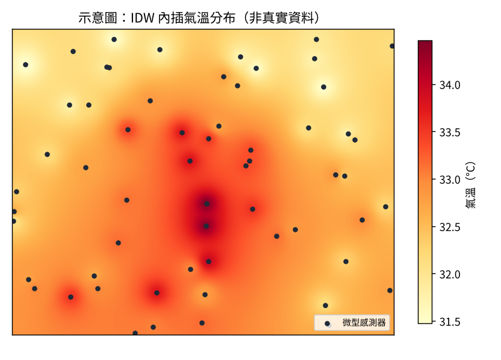

# 第一章　熱危害（H）

## 1.1 家鄉的熱危害經驗

> 引導問題：你家鄉夏天哪些地方最熱？大約是一天中的什麼時段？

（請在這裡寫 3–5 句，一句一行。）

## 1.2 可以用什麼資料量「有多熱」

> 引導問題：如果要知道每個地方、每個小時有多熱，你會想用哪些資料？
> 提示：氣象站、路邊的微型感測器、衛星影像。

（請在這裡寫 2–3 句。）

## 1.3 熱危害地圖（主題1、2 完成後補上）

上圖是示意圖，主題1 會用真實的微型感測器資料畫出逐時 WBGT 地圖，再換掉這張圖。
